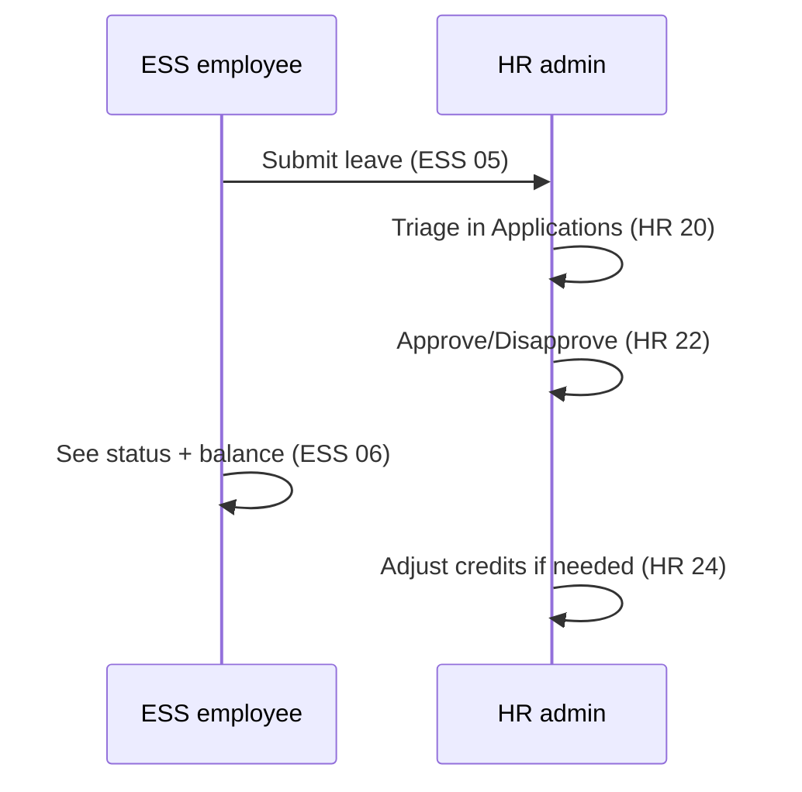
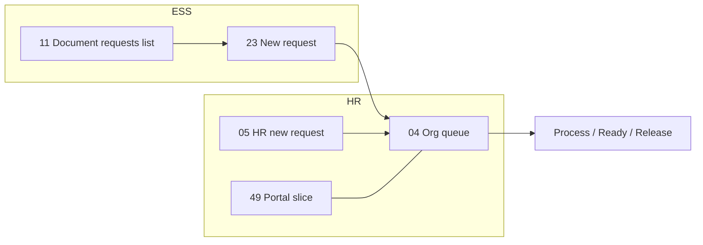
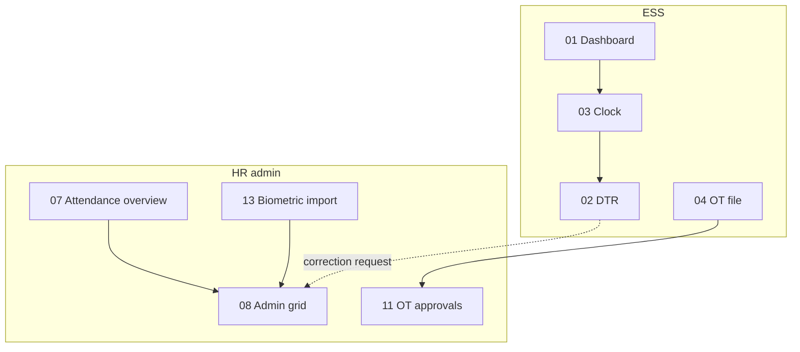

# Screenshot QA Flow Documentation — ESS vs HR Admin

This document describes how the capture sets under `screenshots/ess-qa/` and `screenshots/hr-admin-qa/` relate to each other, to product flows, and to routes documented in [user-roles-and-features.md](./user-roles-and-features.md).

**Purpose of these folders:** numbered PNGs record a structured QA pass per role. The **number prefix** is the order used during that pass, not always the order an end user would click the sidebar.

---

## 1. Role posture (alignment anchor)

| Aspect      | ESS (`employee_self_service`) | HR Admin (`hr_admin`)                                                               |
| ----------- | ----------------------------- | ----------------------------------------------------------------------------------- |
| Data scope  | Own records only              | Organization-wide (employees, leave, attendance, recruitment, etc.)                 |
| Approvals   | None (submits only)           | Leave, OT, document requests, MRF pipeline, etc.                                    |
| Payroll     | Own payslips                  | General + JO/COS + benefits surfaces shown in captures; remittances not in this set |
| Recruitment | N/A                           | Full pipeline in captures                                                           |

---

## 2. Employee Self-Service — `screenshots/ess-qa/`

### 2.1 Capture order (filename sequence)

| #   | File                            | Typical route / area                              | What the screen represents                                                                                                  |
| --- | ------------------------------- | ------------------------------------------------- | --------------------------------------------------------------------------------------------------------------------------- |
| 01  | `01-Dashboard.png`              | `/dashboard`                                      | ESS landing: leave snapshot, payslip teaser, notifications, IPCRF prompts                                                   |
| 02  | `02-DTR.png`                    | `/attendance/dtr`                                 | Personal DTR browser (2-month window per PRD scope)                                                                         |
| 03  | `03-Clock-In-Out.png`           | `/attendance/clock`                               | Web time clock — own clock-in/out                                                                                           |
| 04  | `04-File-Overtime.png`          | `/attendance/overtime` (list) or `.../new`        | File OT — self-service submit                                                                                               |
| 05  | `05-Apply-for-Leave.png`        | `/leave/apply`                                    | New leave application                                                                                                       |
| 06  | `06-My-Credits.png`             | `/leave/credits`                                  | Personal VL/SL ledger, accrual history, Form 6 affordances                                                                  |
| 07  | `07-Leave-Calendar.png`         | `/leave/calendar`                                 | Unit/office approved leave calendar (read-only)                                                                             |
| 08  | `08-My-Payslips.png`            | `/payroll/payslips`                               | Own payslips across payroll types                                                                                           |
| 09  | `09-IPCRF.png`                  | `/performance/ipcrf` or detail                    | Own IPCRF list / form entry                                                                                                 |
| 10  | `10-Announcements.png`          | `/portal/announcements`                           | Read/acknowledge HR memos                                                                                                   |
| 11  | `11-Document-Requests.png`      | `/portal/document-requests`                       | Own document certification requests list (submit + track on portal)                                                         |
| 12  | `12-Org-Chart.png`              | `/org-chart`                                      | Read-only org hierarchy                                                                                                     |
| 13  | `13-My-Profile.png`             | `/profile`                                        | Profile hub                                                                                                                 |
| 14  | `14-Settings.png`               | `/settings`                                       | Account settings hub                                                                                                        |
| 15  | `15-Profile-Employment.png`     | `/profile` (employment tab/section)               | Job info, assignment                                                                                                        |
| 16  | `16-Profile-Government-IDs.png` | `/profile` (IDs section)                          | GSIS, PhilHealth, Pag-IBIG, TIN, etc.                                                                                       |
| 17  | `17-Profile-Leave-Balances.png` | `/profile` or linked leave summary                | Leave balances in profile context                                                                                           |
| 18  | `18-Profile-Documents.png`      | `/profile` (201 attachments)                      | Own document viewer                                                                                                         |
| 19  | `19-Settings-Security.png`      | `/settings` (security)                            | Password / MFA-related controls                                                                                             |
| 20  | `20-Settings-Notifications.png` | `/settings` (notifications)                       | Notification preferences                                                                                                    |
| 21  | `21-Settings-Sessions.png`      | `/settings` (sessions)                            | Active sessions                                                                                                             |
| 22  | `22-Settings-Display.png`       | `/settings` (display)                             | Theme / language                                                                                                            |
| 23  | `23-Document-Requests-New.png`  | `/portal/document-requests` (new / compose state) | **Logical follow-up to 11** — new certification request UI (often same route with expanded form; filename reflects QA step) |

### 2.2 Suggested “story” orders for ESS (beyond numeric filename sort)

- **Daily operations:** 01 → 03 → 02 → 04 (dashboard → clock → DTR review → OT if needed).
- **Leave:** 01 → 05 → 06 → 07.
- **Pay / performance:** 01 → 08 → 09.
- **HR comms / certs:** 01 → 10 → 11 → 23 → 12.
- **Profile deep-dive:** 13 → 15–18 → 14 → 19–22.

---

## 3. HR Administrator — `screenshots/hr-admin-qa/`

### 3.1 Capture order (filename sequence)

| #   | File                              | Typical route / area              | What the screen represents                  |
| --- | --------------------------------- | --------------------------------- | ------------------------------------------- |
| 01  | `01-Dashboard.png`                | `/dashboard`                      | Admin KPIs, pending work queues             |
| 02  | `02-Employee-Records.png`         | `/employees`                      | Directory / search / filters                |
| 03  | `03-New-Employee.png`             | `/employees/new`                  | Manual 201 creation                         |
| 04  | `04-Document-Requests.png`        | `/employees/documents/requests`   | Org-wide certification queue                |
| 05  | `05-New-Document-Request.png`     | `.../requests/new` or equivalent  | HR-initiated request                        |
| 06  | `06-Org-Chart.png`                | `/org-chart`                      | Same read-only chart as ESS                 |
| 07  | `07-Attendance-Overview.png`      | `/attendance`                     | Attendance hub KPIs                         |
| 08  | `08-Admin-Grid.png`               | `/attendance/admin`               | All-employee day grid                       |
| 09  | `09-DTR.png`                      | `/attendance/dtr`                 | Any employee / any month DTR                |
| 10  | `10-Timesheets.png`               | `/attendance/timesheets`          | Payroll-period timesheet list               |
| 11  | `11-Overtime-Approvals.png`       | `/attendance/overtime`            | Approve/deny org-wide OT                    |
| 12  | `12-New-Overtime.png`             | `/attendance/overtime/new`        | OT on behalf of employee                    |
| 13  | `13-Import-Biometric.png`         | `/attendance/import`              | CSV biometric upload                        |
| 14  | `14-Work-Schedules.png`           | `/attendance/schedules`           | Schedule catalog                            |
| 15  | `15-New-Schedule.png`             | `/attendance/schedules/new`       | New schedule definition                     |
| 16  | `16-Attendance-Analytics.png`     | `/attendance/analytics`           | Absence/tardiness/OT analytics              |
| 17  | `17-Biometric-Devices.png`        | `/attendance/biometric`           | Import batch history                        |
| 18  | `18-Web-Time-Clock.png`           | `/attendance/clock`               | Web clock (admin can proxy clock)           |
| 19  | `19-Leave-Overview.png`           | `/leave`                          | Leave admin hub                             |
| 20  | `20-Leave-Applications.png`       | `/leave/applications`             | All applications                            |
| 21  | `21-Apply-for-Leave.png`          | `/leave/apply`                    | Leave filed for someone else                |
| 22  | `22-Approvals-Queue.png`          | `/leave/approvals`                | Pending approvals                           |
| 23  | `23-Leave-Credits.png`            | `/leave/credits`                  | HR user’s own credits (also employee)       |
| 24  | `24-Credits-Admin.png`            | `/leave/credits/admin`            | Accrual + org balances                      |
| 25  | `25-Bulk-Upload.png`              | `/leave/bulk-upload`              | CSV ledger import                           |
| 26  | `26-Advanced-Reports.png`         | `/leave/reports/advanced`         | LWOP / sex-disaggregated / usage            |
| 27  | `27-Leave-Calendar.png`           | `/leave/calendar`                 | Org-wide approved leave                     |
| 28  | `28-Payroll-Overview.png`         | `/payroll`                        | Payroll periods index                       |
| 29  | `29-New-Payroll.png`              | `/payroll/new`                    | New general run                             |
| 30  | `30-Payslips.png`                 | `/payroll/payslips`               | Browse all payslips                         |
| 31  | `31-Payroll-History.png`          | `/payroll/history`                | Historical periods                          |
| 32  | `32-JO-COS-Payroll.png`           | `/payroll/jo-cos`                 | Non-organic payroll                         |
| 33  | `33-Benefits-Bonuses.png`         | `/payroll/benefits`               | Benefits payroll index                      |
| 34  | `34-New-Benefits.png`             | `/payroll/benefits/new`           | New benefits run                            |
| 35  | `35-Performance-Overview.png`     | `/performance`                    | Performance admin dashboard                 |
| 36  | `36-Performance-Cycles.png`       | `/performance/cycles`             | Cycle list                                  |
| 37  | `37-New-Cycle.png`                | `/performance/cycles/new`         | Open new cycle                              |
| 38  | `38-IPCRF.png`                    | `/performance/ipcrf`              | All employees’ IPCRFs                       |
| 39  | `39-OPCRF.png`                    | `/performance/opcrf`              | Office-level OPCRF                          |
| 40  | `40-Recruitment-Overview.png`     | `/recruitment`                    | RPM funnel overview                         |
| 41  | `41-MRFs.png`                     | `/recruitment/mrf`                | Manpower requests                           |
| 42  | `42-New-MRF.png`                  | `/recruitment/mrf/new`            | Create MRF                                  |
| 43  | `43-Vacancies.png`                | `/recruitment/vacancies`          | Published vacancies                         |
| 44  | `44-Applicants.png`               | `/recruitment/applicants`         | Applicant pool                              |
| 45  | `45-Selection.png`                | `/recruitment/selection`          | Selection / ranking                         |
| 46  | `46-Appointments.png`             | `/recruitment/appointments`       | Appointments list                           |
| 47  | `47-New-Appointment.png`          | `/recruitment/appointments/new`   | New appointment → provisioning path         |
| 48  | `48-Announcements.png`            | `/portal/announcements`           | Publish + metrics (contrast: ESS read-only) |
| 49  | `49-Portal-Document-Requests.png` | portal angle on document requests | Cross-cut with 04–05                        |
| 50  | `50-Settings.png`                 | `/settings`                       | HR user’s own account settings              |
| 51  | `51-Profile.png`                  | `/profile`                        | HR user’s own profile                       |

### 3.2 Suggested module groupings (how QA often walks the sidebar)

1. **People & documents:** 01–06
2. **Time & attendance:** 07–18
3. **Leave:** 19–27
4. **Payroll:** 28–34
5. **Performance:** 35–39
6. **Recruitment:** 40–47
7. **Portal / wrap-up:** 48–51

---

## 4. Cross-alignment matrix — same business process, two roles

Use this when explaining parity between ESS captures and HR captures.

| Business process                      | ESS capture(s)                     | HR Admin capture(s) | Direction of workflow                                  |
| ------------------------------------- | ---------------------------------- | ------------------- | ------------------------------------------------------ |
| **Landing / context**                 | 01                                 | 01                  | Parallel entry points                                  |
| **DTR / attendance**                  | 02, 03                             | 07–10, 18           | ESS: self view + clock; HR: grid, DTR, timesheets, hub |
| **Overtime**                          | 04                                 | 11, 12              | ESS submits; HR approves / files on behalf             |
| **Leave application**                 | 05                                 | 21                  | ESS self; HR proxy                                     |
| **Leave balances / credits**          | 06                                 | 23, 24, 25          | ESS ledger; HR + bulk + admin controls                 |
| **Leave calendar**                    | 07                                 | 27                  | Unit view vs org view                                  |
| **Leave approvals / all apps**        | _(ESS only sees own apps via nav)_ | 20, 22              | Approver/HR queue                                      |
| **Payslips**                          | 08                                 | 30                  | Own vs all                                             |
| **Payroll operations**                | —                                  | 28, 29, 31–34       | HR-only in this capture set                            |
| **IPCRF**                             | 09                                 | 38                  | Own vs all                                             |
| **OPCRF**                             | —                                  | 39                  | Supervisor/office instrument — HR admin view           |
| **Announcements**                     | 10                                 | 48                  | Read/ack vs publish                                    |
| **Document certification**            | 11, 23                             | 04, 05, 49          | Request vs org queue + HR new                          |
| **Org chart**                         | 12                                 | 06                  | Same capability, different role header                 |
| **Profile**                           | 13, 15–18                          | 51                  | Own profile depth vs HR user profile                   |
| **Settings**                          | 14, 19–22                          | 50                  | Same account settings pattern                          |
| **Recruitment / RPM**                 | —                                  | 40–47               | HR-only                                                |
| **Biometric / analytics / schedules** | —                                  | 13–17               | HR-only                                                |

---

## 5. Coverage gaps (what one folder has that the other does not)

- **ESS-only in these sets:** explicit Settings sub-screens (19–22), granular profile tabs (15–18), Clock-In-Out as primary self path (03).
- **HR-only in these sets:** employees CRUD (02–03), attendance admin grid & import & biometric & analytics & schedules (08, 13–17), leave approvals and admin credits and bulk/reports (22, 24–26), full payroll (28–34), performance cycles + OPCRF (36–37, 39), entire recruitment block (40–47), `Portal-Document-Requests` admin angle (49).

These gaps match the [Quick Comparison Matrix](./user-roles-and-features.md#3-quick-comparison-matrix) in `user-roles-and-features.md`.

---

## 6. Workflow diagrams (mermaid)

### 6.1 Leave — aligned end-to-end

### 6.2 Document certification request

### 6.3 Time & overtime

---

## 7. How to use this doc in QA

1. **Regression:** replay scenarios by module using section 3.2 (HR) and 2.2 (ESS), not only sorted filenames.
2. **Permission checks:** for each row in section 4, confirm ESS cannot reach HR-only routes from the matrix (middleware + server actions).
3. **New captures:** keep numbering sequential within a role; add a row here when adding screens.

---

_Last aligned to `docs/user-roles-and-features.md` and screenshot filenames as of repository state._
